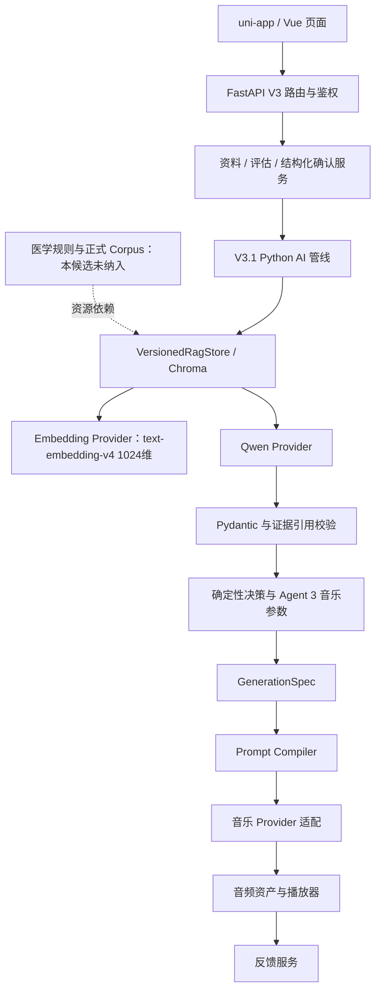

# HarmonyAI（和鸣 AI）

> **S6 团队研发代码快照｜FastAPI · Agent · RAG · Prompt Compiler · uni-app/Vue**
>
> 这是 HarmonyAI 团队实际开发的工程源码，而非新写的演示 Demo。展示代码以文件快照方式选自 [S6 产品恢复版本](https://github.com/chenjz111/HarmonyAI/tree/8e32975607fe96f56852a2b7f7c0ae8f959cb191)，不合并其开发历史，也不覆盖持续开发中的 Sprint 7/8。项目负责人已确认所选团队代码用于公开求职展示；成员原始授权记录未由仓库文档独立核验，第三方素材不在展示许可范围内。

HarmonyAI 探索如何把用户确认的结构化状态、知识检索、模型输出校验和音乐参数设计连接起来，形成可解释的音乐辅助放松体验。项目已有 FastAPI 后端、Agent 管线、Chroma 检索、Prompt Compiler、音乐 Provider 适配和 uni-app/Vue 前端。它是团队研发项目，尚无临床疗效或完整生产交付结论。

## 三分钟看项目

**产品流程：** 资料/问卷输入 → 用户确认 → V3.1 AI 处理管线 → 知识检索与校验 → 音乐参数决策 → Prompt 编译 → 音乐 Provider → 播放与反馈。

**建议从下面的入口直接点进实际代码。** 当前展示的是研发快照，不代表已经完成生产部署、临床验证或端到端验收。

## 核心源码导航

| 想了解的能力 | 已有真实代码 | 建议阅读重点 |
|---|---|---|
| Python / API 工程 | [FastAPI 入口](backend/app/main.py)、[V3 路由](backend/app/routers/v3/)、[Schema](backend/app/schemas/v3/) | 路由、契约、业务服务、鉴权与错误边界 |
| AI 工作流与证据边界 | [V3.1 管线](backend/ai_engine/v3/v31_pipeline.py)、[模型输出校验](backend/ai_engine/v3/diagnosis_pipeline.py) | `execute_v31_ai_pipeline()`、结构化事实与引用校验 |
| RAG | [VersionedRagStore](backend/ai_engine/v3/rag_store.py)、[语料校验](backend/ai_engine/v3/rag_ingestion.py) | 版本、批准 ID、阈值、完整性；索引故障与无命中分开 |
| Prompt 工程 | [Prompt Compiler](backend/ai_engine/v3/prompt_compiler.py) | `compile_music_prompt()`、确定性编译、方言与 checksum |
| 外部 API 适配 | [Qwen 兼容 Provider](backend/ai_engine/providers.py)、[TokenHub/MiniMax](backend/ai_engine/v3/tokenhub_minimax_music_provider.py) | JSON 输出、错误分类、调用次数与收费重试边界 |
| 前后端协作 | [API 封装](frontend/common/api-v3.js)、[播放器](frontend/pages/v3-player/v3-player.vue)、[播放器控制器](frontend/common/player-controller.js) | 状态流转、鉴权下载、生命周期和 Fake/真实模式 |
| 测试与验收 | [原有测试](tests/)、[本候选验证记录](docs/showcase/VERIFICATION.md) | 实际运行范围、失败/未验证项与历史记录的区别 |

所有复用文件的具体来源与展示许可标记见 [源码清单](docs/showcase/SOURCE_MANIFEST.csv)。逐文件实际作者仍有 UNKNOWN，项目负责人不是全部源码的独立作者。

## 真实系统架构

下图描述所选 S6 代码的组件关系；被排除的资源明确标出。V3.1 主链是 Python Service 编排，不是全链路 LangGraph Supervisor。



- LLM 输出需要结构和业务校验，不能直接改写已确认的事实。
- Agent 3 包含确定性规则决策，不应全部描述为模型自由推理。
- `langgraph_workflow.py::build_stub_graph()` 是真实 LangGraph 图，但节点为离线 Stub；`real_workflow.py::build_real_graph()` 仍有 generation stub。不能据此称为完整五 Agent 生产链。
- 代码中的 Provider 调用是显式适配，不等于模型自主选择工具；当前不声称完整 Tool Calling 或 Supervisor 能力。

## 技术栈与完成程度

| 模块 | 已有实现 | 本候选状态 |
|---|---|---|
| FastAPI / Pydantic | 入口、路由、Schema、Service、异常边界 | 源码已纳入；服务启动本轮未验收 |
| SQLAlchemy / SQLite / MySQL | 模型、初始化及迁移代码 | 迁移源码已纳入；数据库与种子数据未纳入，真实 MySQL 未验证 |
| V3.1 Agent 管线 | 确认状态→检索→模型校验→规则→音乐参数 | 核心源码已纳入；正式数据资源缺失 |
| Chroma / Embedding | `VersionedRagStore`、版本/ID/阈值门禁 | 实现已纳入；正式 Corpus、索引和真实 Embedding 未验收 |
| Prompt Compiler | 中间模型、Provider 方言、校验与身份摘要 | 实现和原测试已纳入；结果见验证记录 |
| Qwen / 音乐 Provider | 请求适配、失败语义、受控调用边界 | 实现已纳入；本轮没有真实调用 |
| LangGraph | Stub 图和部分旧版 real workflow | 演示与部分实现，不代表当前主链全部使用图编排 |
| Vue 3 / uni-app | 资料、确认、问卷、生成、播放与反馈页面 | 源码已纳入；原设计图片/音频未纳入，H5/设备未验收 |
| 反馈 | S6 既有反馈与偏好相关代码 | 按 S6 原样保留；不将 S7 的安全关闭/新授权反馈当作已回移，不宣称适合上线 |

Qwen 模型由配置选择；正式 Embedding 契约是 `text-embedding-v4@1024`。不沿用初始 README 中未经当前代码支持的固定 Qwen2.5、BGE-M3、Supervisor 或 Docker 交付声明。

## 用户流程与界面

已有页面覆盖：资料输入 → 摘要与结构化确认 → 问卷/补充信息 → 目标选择 → 生成状态 → 播放及解释 → 反馈。

页面见 [pages.json](frontend/pages.json) 和 [V3 页面目录](frontend/pages/)。`api-v3.js` 区分 real、显式 mock 和 hybrid；Mock/hybrid 截图不能证明真实 AI 联调。

目前没有权利来源已确认、可新增到公开版本的截图或音频，因此本候选不嵌入现有 PNG/WAV，也不使用占位图片冒充真实运行截图。上面的架构图是本次基于代码新写的组件图，仍待团队审核。

## 目录结构

```text
backend/
  app/                 FastAPI、Schema、ORM、Service
  ai_engine/           Agent、LangGraph、Provider、RAG、Compiler
  migrations/          原有迁移源码
frontend/              uni-app / Vue 页面、状态与测试
prompt/                原有版本化模板（公开许可待确认）
tests/                 原有 Python 测试；部分外部 fixture 未纳入
docs/showcase/         本次自撰说明、验证记录、来源清单
pyproject.toml
requirements.txt
requirements-ocr.txt
```

当前没有 `knowledge/` 正式资源、数据库、`.env`、图片、字体、音乐和原始运行日志。前端及测试中保留原资源引用，以如实暴露缺口，不修改有效断言或伪造资源验收。

## 安装、运行与测试

**当前候选不是一键运行包。** 请先阅读 [运行条件与步骤](docs/showcase/RUNNING.md)。本轮没有安装依赖，没有启动服务或执行迁移，也没有构建前端。

- Python 元数据声明 >=3.10；本轮验证使用的实际解释器版本记录在验证文档，不据此保证全部版本兼容。
- 后端运行依赖见 requirements；OCR 为单独可选依赖。完整依赖图未锁定。
- 前端 package/lock 原样保留；`dev:h5`、`build:h5` 是原工程脚本，不等于本候选已成功构建。
- 后端启动会初始化数据库，真实 AI 配置可能触发外部服务；请勿将生产凭据或数据库放入候选。
- 本轮仅使用清洁合成环境、隔离 SQLite/临时目录及外部离线保护器验证原有专项测试。精确范围、计数和外部保护器依赖见 [验证记录](docs/showcase/VERIFICATION.md)。

## 我的职责与团队贡献

陈家智（Project Leader & AI Architect）：主要负责产品流程、技术方案与 Agent I/O 合同协调、任务分工、代码审查及集成验收组织；使用 Codex、Claude Code 等工具辅助工程研发。

可核查的协作记录包括：[V3 流程决策与集成协调（Issue #81）](https://github.com/chenjz111/HarmonyAI/issues/81)、[Sprint 7 共享模型与集成任务（Issue #150）](https://github.com/chenjz111/HarmonyAI/issues/150)。工程示例包括 [S6 Prompt Compiler（PR #148）](https://github.com/chenjz111/HarmonyAI/pull/148) 和 [前端流程（PR #92）](https://github.com/chenjz111/HarmonyAI/pull/92)；这些是团队产出，不据此声明所有代码均由负责人手写。

既有团队分工包括：钟睿宸参与 AI 工程，蔡子鑫参与后端平台，彭翔参与客户端。角色分工不等于逐文件实际作者认定；具体实现、共同作者及 AI 辅助归属仍需逐项核对。不能将本仓库全部代码描述为本人独立手写。

已有团队工程可用于讨论接口、证据权威、Prompt 编译、失败边界和测试设计。个人主张应结合具体 Issue、PR、审查和验收记录，见 [版本与贡献说明](docs/showcase/PROVENANCE.md)。

## 本轮离线验证摘要

| 检查 | 新候选实际结果 |
|---|---|
| Prompt Compiler | 91 passed |
| LangGraph Stub 图 | 2 passed；不是完整真实模型工作流 |
| TokenHub Provider 同步 Fake 用例 | 77 passed / 1 deselected；异步用例单独超时 |
| 完整测试收集 | 1837 collected / 6 errors；不等于通过 |

没有执行真实模型、Embedding、音乐 API 或前端构建。详细命令、环境修正、残留错误和超时诊断见 [验证记录](docs/showcase/VERIFICATION.md) 与 [复现问题分类](docs/showcase/REPRODUCIBILITY.md)。

## 当前限制与公开状态

1. 本候选从一个固定 S6 代码版本整理，没有混入 S7 业务改动；S7 后续安全修复和新增功能不能视为本版本已经具备。
2. 项目负责人确认本次选定的团队源码可公开用于求职展示；逐文件作者及成员原始许可记录尚未独立核验，未纳入的医学资源、音频、图片及第三方素材不在许可范围内。
3. 医学资源、图片音频和种子数据缺失，完整 App、正式 RAG、视觉与设备验收仍未完成。
4. 本候选未导入 S6 提交历史，main 祖先与候选快照中均未发现已知历史 SQLite 对象。其他公开分支中的数据库暴露仍未解决；main 原有两张 PNG 的历史权利也仍待确认。新分支不能清除其他引用的风险。
5. 旧版 README 中的 MIT 声明不足以自动证明全部团队贡献及第三方资源均可再授权。本快照不附加未经确认的开源许可证；允许公开查看不等同于允许他人任意复制、修改或商用。

这是便于审阅实际工程设计与代码的开发快照，不是对完整产品、正式医学知识库或生产安全性的交付承诺。后续 Sprint 7/8 在独立开发分支持续进行，详见 [版本与历史说明](docs/showcase/HISTORY_AND_RELEASE.md)。
